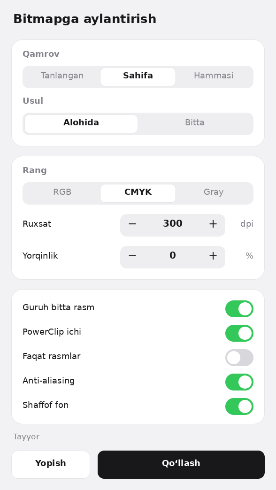

# Bitmap — CorelDRAW plagini

Obyektlarni bir bosishda bitmapga aylantiradi.

## Sozlamalar

| Blok | Sozlama | Qiymatlar |
|---|---|---|
| 1 | Qamrov | Tanlangan · Sahifa · Hammasi |
| 1 | Usul | Alohida · Bitta |
| 2 | Rang | RGB · CMYK · Gray |
| 2 | Ruxsat | 30–3000 dpi (− / + tayyor qiymatlar bo‘yicha) |
| 2 | Yorqinlik | −100 … +100 % (− / + qadami 5) |
| 3 | Guruh bitta rasm | Guruh butunligicha bitta bitmap bo‘ladi |
| 3 | PowerClip ichi | PowerClip ichidagilar bitmap qilinadi, ramka vektor qoladi |
| 3 | Faqat rasmlar | Faqat bitmap obyektlar o‘zgaradi |
| 3 | Anti-aliasing | Silliq chetlar |
| 3 | Shaffof fon | Bitmap foni shaffof |

Har bir sozlamaning izohi sichqoncha olib borilganda ko‘rinadi.
Hammasi bitta **Ctrl+Z** bilan qaytariladi. Qulflangan va yashirin qatlamlarga tegmaydi.

## O‘rnatish

1. **Alt+F11** → **GlobalMacros** → **File → Import** → `modBitmap.bas`.
2. **Insert → UserForm** → Properties’da `(Name)` = **`frmBitmap`**.
3. Oynada o‘ng tugma → **View Code** → `frmBitmap_kod.txt` dagi hamma kodni joylang → **Ctrl+S**.

Ishga tushirish: **Tools → Macros → Run Macro** → `BitmapKonverter`.
Panelga tugma: **Tools → Customization → Commands → Macros**.

Yumaloq bloklar `%TEMP%` papkasidagi kichik `bmpk_*.bmp` rasmlar orqali chiziladi.
